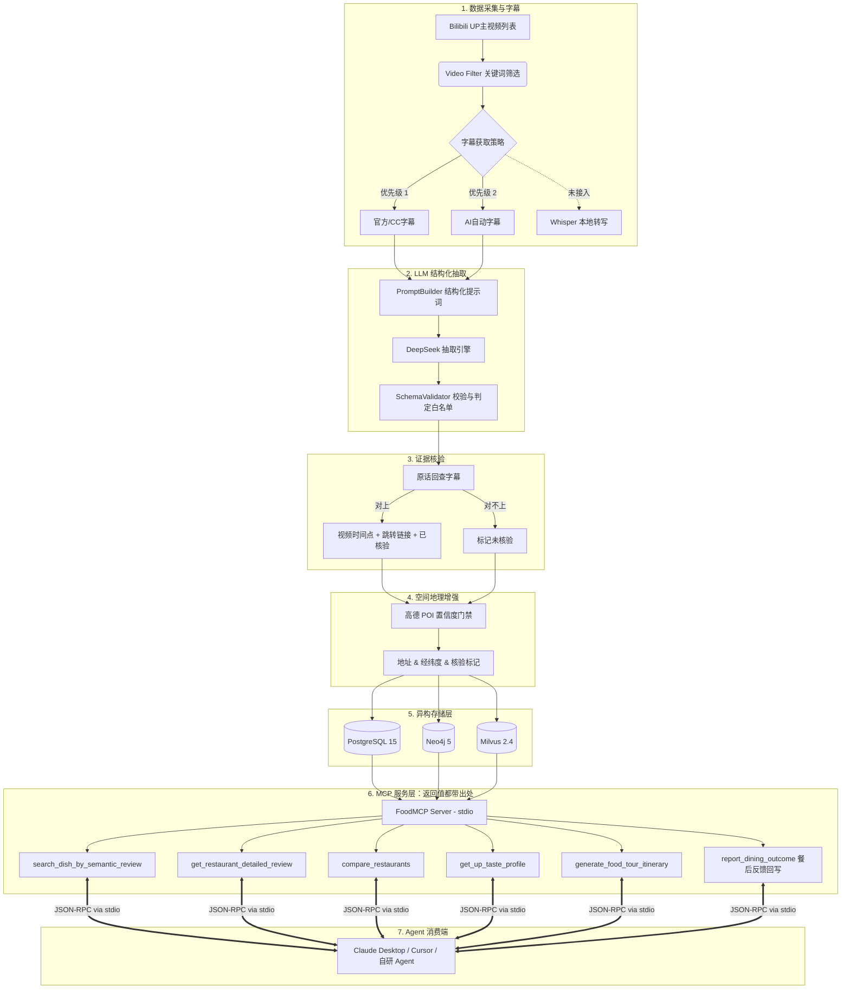
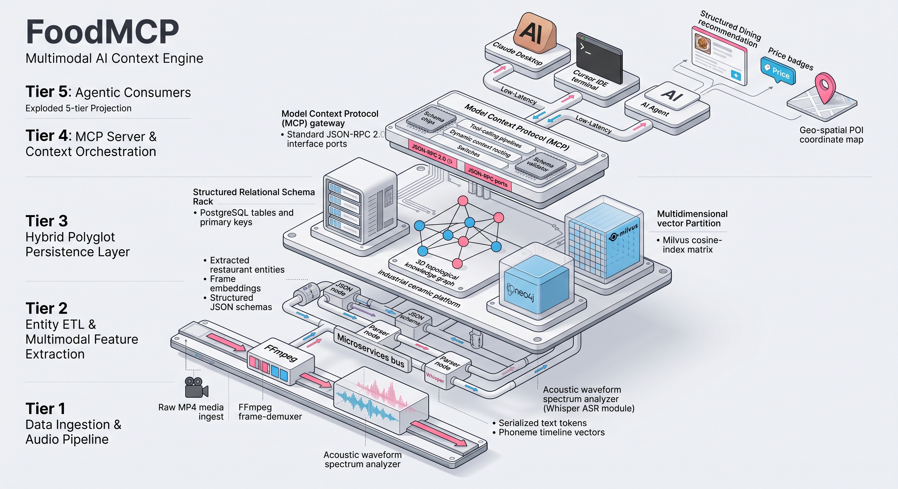

<div align="center">

# 🍽️ FoodMCP：把 B 站探店视频变成可核对的菜品级证据

> 从非结构化探店长视频到"菜品级"结构化数据，每条结论都带着出处：哪位 UP 主、哪个视频的第几秒、原话怎么说  
> 通过 Model Context Protocol (MCP) 交给 AI Agent

[](https://www.python.org/)
[](https://modelcontextprotocol.io/)
[](https://www.deepseek.com/)
[](https://www.docker.com/)
[](https://www.postgresql.org/)
[](https://neo4j.com/)
[](https://milvus.io/)
[](LICENSE)

[中文文档](#-一产品概述) · [系统架构](#-三系统架构设计) · [关键设计](#-四关键设计与工程实现) · [极速上手](#-六快速开始) · [Claude/Cursor配置](#-七-claude-desktop--cursor-接入指南) · [产品白皮书 (PORTFOLIO)](PORTFOLIO.md)

</div>

---

## 📌 一、产品概述

### 1.1 为什么做这个项目？(痛点与背景)

传统餐饮点评平台（大众点评、美团）与 B 站美食内容生态存在天然的痛点鸿沟：
- **大众点评/美团**：评分机制通胀、刷单泛滥，用户评价停留在"店铺整体"粒度，用户无法通过口语化需求检索特定菜品（如："想吃北京肉质扎实、锅气足但不咸的干炸丸子"）。
- **B 站美食探店**：UP 主实地试吃、有名有姓、细节丰富，但**长视频信息密度极低**。用户必须逐个看完 10~20 分钟的视频，或在弹幕和评论区中爬楼，信息无法被结构化索引与交叉验证。

**FoodMCP 的解决方案**：
构建自动化流水线，把 B站探店视频的字幕通过**大模型信息抽取**转化为 **`城市 → 餐厅 → 菜品 → 五维度评价 → 情绪`** 的结构化数据。每条 UP 主原话入库前都会**回查字幕核验**，并记录它在视频里的时间点。最后基于 **MCP (Model Context Protocol)** 标准协议对外提供 Agent 工具，所有返回值都带出处。

### 1.2 核心主张：可核对，而不是更诚实

> 我们不假设 UP 主比匿名用户更诚实。我们押注的是：一个有名有姓、有原话、有视频时间点的判断，可以被核对、被反驳、被计数；一个 4.7 分不可以。FoodMCP 做的事，是把"可核对"变成 Agent 可以直接使用的字段。

参照：美团孵化的美食社区"鸭觅"从另一端解决同一个问题。它靠筛选和问责推荐官回答"该信谁"，FoodMCP 靠可核对的证据回答"凭什么信"。两者的机制对照与形态互换的思想实验见 [PORTFOLIO 第七章](PORTFOLIO.md#-七对照美团鸭觅与形态互换)。

### 1.3 差异化竞争矩阵

| 维度 | 大众点评 / 美团 | B 站原生搜索 / 小程序 | 🌟 FoodMCP |
| :--- | :--- | :--- | :--- |
| **评价真实度** | ⭐⭐ 刷分/商业化严重¹ | ⭐⭐⭐⭐ UP 主实地试吃 | 不自评星级：每条结论附 UP 主、原话与视频时间点，可回看核对 |
| **信息粒度** | 餐厅级（整体打分） | 视频级（需全片观看） | **菜品级**（单菜五维度细分） |
| **检索方式** | 关键词标签硬匹配 | 视频标题硬匹配 | **自然语言语义检索**，可以只查"别点什么" |
| **多人评价** | 平均分 | 各自独立的视频 | **按 UP 主计票**：共识、争议、孤证分开呈现 |
| **AI 生态集成** | 封闭生态 | 封闭生态 | **标准 MCP 协议**，Agent 端零适配（数据需自行采集） |

¹ 行业自己的动作可以佐证这个问题：美团 2025 年孵化的美食社区鸭觅以不恰饭的推荐官为核心（[腾讯新闻 2025-09-05](https://news.qq.com/rain/a/20250905A022RI00)）；高德 2025 年 9 月上线的扫街榜按导航到店、复购等行为数据排名，并称可以避免常规榜单被刷分（[界面新闻](https://www.jiemian.com/article/13330096.html)、[虎嗅](https://www.huxiu.com/article/4891260.html)）。

---

## 🎯 二、产品价值与应用场景

| 场景 | 用户 / Agent 的问题 | FoodMCP 怎么回答 |
| :--- | :--- | :--- |
| 🔍 菜品级语义检索 | "想找肥而不腻、卤香味醇厚的卤肉饭" | 向量检索 UP 主原话，每条结果附 UP 主、视频链接（带时间点）与核验状态 |
| 📊 多 UP 主证据 | "这家店哪些菜被多位 UP 主点名？有没有人说别点？" | 按 UP 主计票，标出共识、争议、孤证；不输出平均分 |
| 🚫 反向检索 | "去这家店吃，哪些菜 UP 主说别点？" | `sentiment_filter=avoid`；避雷结论要求原话能在字幕中找到 |
| 🗺️ 美食动线规划 | "生成 3 天上海老字号打卡路线" | LLM 按高德坐标编排路线；必点、避雷与原话只取自证据数据 |
| 🍽️ 吃完之后 | "上次那家的鱼确实不错" | Agent 代收餐后反馈，挂在 UP 主的那条说法上，累计成"谁在什么菜系上说得准" |

---

## 🏗️ 三、系统架构设计

系统整体采用 **分层解耦 + 异构混合存储 + 标准化协议暴露** 的架构：



<div align="center">
  
  <br><sub>设计愿景图（不是当前实现）：图中的视频与音频处理链路（FFmpeg、Whisper、帧向量）尚未实现，当前系统只处理字幕文本，以上方架构图为准。</sub>
</div>

---

## ⚙️ 四、关键设计与工程实现

### 1. 🔎 证据链：原话必须能对回字幕
* **问题**：LLM 抽取的"UP 主原话"可能被改写甚至编造；LLM 也看不到字幕的时间轴，它给出的时间点不可信。
* **做法**：Prompt 要求原话逐字摘录。入库前把原话对回字幕（精确匹配，或容忍 ASR 错字的模糊匹配）：对上的记录字幕片段起点作为视频时间点，并生成 `https://www.bilibili.com/video/BV…?t=秒` 跳转链接；对不上的标 `quote_verified=false`。离线评测的保真度与线上核验共用同一套规则（`src/evidence/quotes.py`）。每次运行都会输出**可核对率**：原话能在字幕中找到的菜品占比。
* **局限**：只核验"这句话有没有说过"，不核验"是不是在说这道菜"。

### 2. 📊 不输出平均分：按 UP 主计票
* **问题**：一个推荐加一个踩雷的均值是 0，和两个"一般"无法区分；1 条好评的店会赢过 9/10 好评的店。
* **做法**：每位 UP 主对每道菜只算一票（管线重跑产生的重复评价也只算一次），并给出证据等级：**孤证 / 共识 / 争议**。对比工具优先只比较两家都去过的 UP 主，因为同一个人的标准更可比；任一家少于 3 条判定时不下结论（`src/evidence/consensus.py`）。
* **负面结论的举证要求更高**：避雷榜只收录原话已核验的踩雷；未核验的只作为原话提及返回。

### 3. 🧠 LLM 抽取：判定宁轻勿重
* **判定口径**：只有 UP 主明确不建议点，或批评指向核心品质（不新鲜、有异味、口味明显失败）时才判"踩雷"；有保留的评价、态度模糊的一律判"一般"，不替一个有名有姓的人加重语气。代价是会漏掉一部分警告。
* **非标准输出**：只按白名单映射意思明确的同义词（如"别点"→踩雷），其余一律记为"一般"并保留原值待复核。宁可漏判，也不把差评说成推荐。
* **失败处理**：LLM 调用失败时任务标记为 FAILED，下次运行自动重试，不会被当作"抽到 0 家餐厅"落盘。
* **双 API 架构**：抽取用 DeepSeek（`deepseek-chat`），向量化用 OpenAI（`text-embedding-3-small`），两者可独立替换。

### 4. 🗄️ 异构三库存储
* **PostgreSQL**：餐厅、菜品、UP 主、评价及其出处，承担全部结构化查询，包括证据分布。
* **Milvus**：UP 主原话的 1536 维向量（HNSW + COSINE）。索引的是原话，而不是 LLM 写的摘要，所以检索命中的永远是可以核对的话。
* **Neo4j**：UP 主—餐厅—菜品的评价关系。MVP 规模下 PostgreSQL 足以完成全部查询；保留图数据库，是为第②层的 UP 主一致性计算：在"UP 主 × 菜品"二部图上计算两两一致率（见 [PORTFOLIO 6.4](PORTFOLIO.md)）。

### 5. 🗺️ 高德 POI 地理增强
* **做法**：按"餐厅名 + 城市"召回多个候选，用名称相似度、城市一致性与餐饮分类打分。低于阈值的候选拒绝采纳，降级为城市中心坐标；采纳但未达高置信度的标为未核验。"不确定"作为数据交给下游：行程工具只把已核验的坐标标为可靠。
* **已知局限**：城市目前是一次运行的参数（`--city`），而 UP 主会跨城探店。在 `--city 北京` 下，"山居满陇"当初误配的那家平谷农家院得分 0.515，仍高于拒绝线 0.45。修复方向是按餐厅推断城市。

### 6. 🔌 MCP 协议落地
* 基于 Anthropic 官方 `mcp-python` SDK，通过 `stdio` 暴露 6 个工具（5 个查询 + 1 个餐后反馈回写），可接入 Claude Desktop、Cursor 等支持 MCP 的客户端。
* **Tool 描述就是产品界面**：引用规范直接写在 Tool 描述里。向用户转述时要注明哪位 UP 主、哪个视频；`quote_verified=false` 时只转述原话，不下结论。
* **餐后反馈回写**：数据层看不到用户吃完之后满不满意，这是选择 MCP 的代价。`report_dining_outcome` 让 Agent 在下一次对话里代收反馈，挂在具体的那条 UP 主说法上（每条说法返回 `review_id`），一顿饭验证几位 UP 主就记几行，共享一个 `report_id`。由此可以算出北极星（照推荐去吃没有踩雷的比例，按顿计）和每位 UP 主按菜系拆分的一致率（`src/evidence/feedback.py`）。目前只有通道，还没有真实反馈数据；本地 stdio 部署下也没有鉴权。

### 工程备注：B 站接口
B 站接口对非浏览器请求会返回 412。`bilibili-api-python` 在安装 `curl-cffi` 后会自动使用浏览器 TLS 指纹的客户端。采集只读取公开视频的字幕与元数据，请求间隔 ≥ 2s；采集的数据只用于本地研究，不随仓库分发。

---

## 📊 五、MVP 验证成果

以美食 UP 主 **"特厨隋卞"**（厨师背景）的视频进行端到端验证：

| 验证指标 | 实测数据 |
| :--- | :--- |
| **视频采集样本** | 60 个视频 |
| **探店视频判定** | 37 / 60 个（关键词规则初筛，未做准确率标注） |
| **端到端处理** | 2 个视频 |
| **入库餐厅** | 2 家（8.4 优雅河鲜、山居满陇） |
| **提取精细化菜品** | 11 道（含五维度细节与 UP 主原话） |
| **单元测试** | 76 / 76 全部通过（基于 mock，集成测试尚未编写） |

### 5.1 真实运行产物（节选）

| 餐厅 | 菜品 | 判定 | UP 主原话（节选） |
| :--- | :--- | :--- | :--- |
| 8.4优雅河鲜 | 一帆风顺（鱼） | 推荐 | 这鱼肉真的好嫩……吃到最后还是有一点点土腥味，我能尝出来，你们不一定。 |
| 8.4优雅河鲜 | 生态白胡子（豆豉做法） | 一般 | 鱼的品质还是不错的……但 598 的花拉丁，价格版的顶配奥拓，它也是奥拓呀。 |
| 8.4优雅河鲜 | 乡村藿香烧米翘 | 踩雷 | 198 块钱，两块鱼肉一疙瘩面，而且你这个位置也没给我选好。 |
| 山居满陇 | 锅贴鱼片 | 推荐 | 进嘴是三种口感……我真的不舍得给他差评，现在这个菜做的太少太少了，能做成这样的不容易。 |
| 山居满陇 | 老乾隆御香鸭 | 踩雷 | 甜跟花椒的味道没搭到一块……这个菜做的就很一般很一般。 |

这几条是真实数据里最难的情况。没有一条是 UP 主撒谎，难点都在"话该怎么读"：
- **一帆风顺**：专家才吃得出的瑕疵（"我能尝出来，你们不一定"）。
- **生态白胡子**：好坏取决于预算。
- **乡村藿香烧米翘**：价格、座位这些店级因素混进了菜品判断。
- **锅贴鱼片**：按手艺打分（"能做成这样的不容易"），不是按好不好吃打分。
- **老乾隆御香鸭**：客气话的翻译（"很一般很一般"被判成踩雷）。

它们是 [PORTFOLIO 第六章](PORTFOLIO.md) 细化可信模型的出发点。

### 5.2 质量体系的诚实切面
- 一道菜名被抽成了"泰雕熟虾最池底"（应为花雕醉虾类菜品），源于 AI 字幕的识别错误。当时的置信度给它打了满分，因为置信度只衡量字段齐不齐。这是后来改用"原话回查字幕"作为闸门的直接原因。
- "山居满陇"曾被高德匹配到平谷的一家农家院。置信度门禁随后上线，但根因（城市是运行级参数）还在，见第四节第 5 条。
- 黄金评测集目前是 8 条手写的合成样本（餐厅与 UP 主均为虚构），其中的踩雷都是明说的，测不出含蓄差评；基于真实字幕的评测集尚待建立。

---

## 🚀 六、快速开始

### 6.1 前置要求
- Python 3.11+
- Docker & Docker Compose
- 高德开放平台 Web 服务 Key
- DeepSeek 或 OpenAI API Key

### 6.2 步骤 1: 克隆项目并安装依赖

```bash
git clone https://github.com/JohnMaxwell0123/FoodMCP.git
cd FoodMCP

# 创建并激活虚拟环境
python -m venv .venv
.venv\Scripts\activate     # Windows
# source .venv/bin/activate # Linux / macOS

# 安装核心依赖与开发套件
pip install -e ".[dev]"
```

### 6.3 步骤 2: 一键启动三库环境 (Docker Compose)

```bash
docker compose up -d
```
启动成功后将包含：
- **PostgreSQL 15**：端口 `5433`
- **Neo4j 5**：端口 `7474` (Web 管理台) / `7687` (Bolt)
- **Milvus 2.4**：端口 `19530`

### 6.4 步骤 3: 环境变量配置

```bash
cp .env.example .env
```
编辑 `.env` 填入您的配置：
```ini
# B站凭据 (从浏览器 Cookie 复制)
BILIBILI_SESSDATA=your_sessdata
BILIBILI_BILI_JCT=your_bili_jct
BILIBILI_BUVID3=your_buvid3

# LLM 与 Embedding
OPENAI_API_KEY=your_deepseek_api_key
OPENAI_BASE_URL=https://api.deepseek.com
LLM_MODEL=deepseek-chat

EMBEDDING_API_KEY=your_openai_api_key
EMBEDDING_BASE_URL=https://api.openai.com/v1
EMBEDDING_MODEL=text-embedding-3-small

# 高德地图
AMAP_API_KEY=your_amap_key
```

### 6.5 步骤 4: 运行自动化采集与处理流水线

```bash
# 采集指定 UP 主（如特厨隋卞 MID: 1462401621）的探店视频并写入三库
python -m scripts.run_pipeline --up-mid 1462401621 --city 北京 --limit 5
```

> `--city` 目前作用于整次运行。UP 主跨城探店时，请按城市分批运行；按餐厅推断城市在 Phase 2。

### 6.6 为已有数据回填证据字段（可选）

早期入库的评价没有原话核验结果和视频时间点。以下命令用本地缓存的字幕回填，不重新调用 LLM：

```bash
python -m scripts.backfill_evidence              # 回填核验结果与视频时间点
python -m scripts.backfill_evidence --with-dates # 同时调用 B 站接口补全视频发布日期
```

### 6.7 查看可信度报告（可选）

```bash
python -m scripts.trust_report
```
输出三个数：**可核对率**（原话能在字幕中找到的评价占比，领先指标）、**北极星**（照推荐去吃没有踩雷的比例，需要餐后反馈）、每位 UP 主说法与食客反馈的一致率（按菜系拆分，反馈少于 5 条时标"仅供参考"）。

---

## 🤖 七、Claude Desktop / Cursor 接入指南

作为原生 MCP Server，可以直接配置在 Claude Desktop 或 Cursor 中：

### Claude Desktop 配置 (`claude_desktop_config.json`)
```json
{
  "mcpServers": {
    "food-mcp": {
      "command": "/path/to/FoodMCP/.venv/bin/python",
      "args": [
        "-m",
        "src.mcp_server.server"
      ],
      "cwd": "/path/to/FoodMCP"
    }
  }
}
```
> Windows 下 `command` 改为 `C:\\path\\to\\FoodMCP\\.venv\\Scripts\\python.exe`，`cwd` 同理。

### 可用 MCP Tools 列表：
1. `search_dish_by_semantic_review`：输入口语化的口味需求，返回语义最相近的菜品与 UP 主原话。每条结果附 UP 主、视频链接（带时间点）、发布日期和 `quote_verified`；`sentiment_filter=avoid` 只查 UP 主说别点的菜。
2. `get_restaurant_detailed_review`：餐厅的菜品级证据分布。按 UP 主计票，标注孤证、共识、争议，不输出平均分。
3. `compare_restaurants`：横向对比两家餐厅的推荐率、踩雷率、推荐菜、避雷菜与争议菜。优先比较两家都去过的 UP 主，样本不足时不下结论。
4. `get_up_taste_profile`：UP 主的城市足迹、常探菜系、判定分布与代表性原话。`selectivity` 只描述给出踩雷的频率，不代表可信度（可信度尚未计算）；`diner_feedback` 是食客反馈与这位 UP 主说法的一致率，按菜系拆分。
5. `generate_food_tour_itinerary`：指定城市与天数，按高德坐标编排路线。只安排有推荐证据的餐厅；必点、避雷与原话只取自证据数据，越界内容会被自动删除。
6. `report_dining_outcome`：记录用户吃完之后的感受（liked / neutral / disliked），挂在之前展示过的 UP 主评价上（`review_ids`，或餐厅名 + 菜名）。返回每条说法与食客判断是否一致，以及这些 UP 主当前的一致率。这是唯一会写入数据的工具。

---

## 📂 八、项目代码结构

```
foodrecomandation/
├── config/                  # Pydantic Settings 全局统一配置
│   └── settings.py
├── src/
│   ├── models/              # Pydantic 数据模型 (Restaurant, Dish, Review...)
│   ├── collector/           # B站采集 (视频列表 + 探店筛选 + 字幕下载)
│   ├── transcriber/         # Whisper 语音转录 (本地 ASR 兜底，尚未接入流水线)
│   ├── extractor/           # LLM 结构化信息抽取 (Prompt + 校验器)
│   ├── evidence/            # 证据层 (原话核验、视频时间点、按 UP 主计票、餐后反馈汇总)
│   ├── eval/                # LLM 抽取评测 (实体 F1 / 情感混淆矩阵 / 原话保真度)
│   ├── geocode/             # 高德地图 POI 检索与地理编码
│   ├── storage/             # 异构存储层 (PostgreSQL + Neo4j + Milvus)
│   ├── pipeline/            # 端到端自动化 Pipeline 编排
│   └── mcp_server/          # Model Context Protocol 服务端
├── scripts/
│   ├── run_pipeline.py      # CLI 执行入口
│   ├── run_eval.py          # 基于 data/eval 黄金集的抽取评测 CLI (支持 --mock 离线模式)
│   ├── backfill_evidence.py # 为已有评价回填原话核验结果与视频时间点
│   ├── trust_report.py      # 可信度报告：可核对率、北极星、UP 主一致率
│   └── demo_bilibili.py     # 连通性测试脚本
├── tests/                   # 核心模块自动化单元测试
├── docker-compose.yml       # 一键三库编排文件
├── pyproject.toml           # 现代 Python 依赖管理
├── PORTFOLIO.md             # 📖 产品设计白皮书：可信模型 + 鸭觅对照 + 商业思考
├── SUMMARY.md               # 📄 项目 Executive Summary
├── presentation.html        # 💻 交互式产品演示页面
└── PROGRESS.md              # 🛠️ 研发全流程演进记录
```

---

## 👥 维护与设计文档

本项目由 **[John Maxwell (@JohnMaxwell0123)](https://github.com/JohnMaxwell0123)** 独立构思、设计与落地：
- 📚 **产品设计与可信模型**：详见 **[产品设计白皮书 (PORTFOLIO.md)](PORTFOLIO.md)**
- 📄 **架构与设计概要**：详见 **[一页纸项目概要 (SUMMARY.md)](SUMMARY.md)**
- 💻 **交互式展示**：详见 **[Web 端产品演示 (presentation.html)](presentation.html)**

欢迎在 GitHub 提交 Issue 或 PR 参与交流！

---

## 📄 License

本项目采用 [MIT License](LICENSE) 开源协议。
